
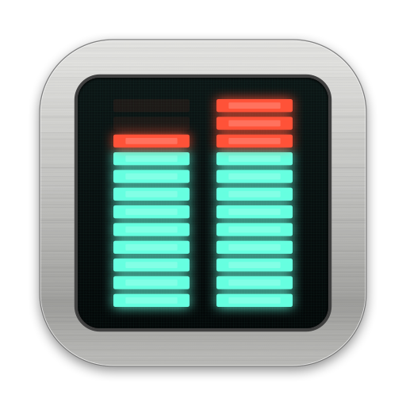

<h1 align="center">Peak Hold Bar</h1>

<a href="README.md">English</a> · Deutsch

Ein Pegelmeter für macOS im Look eines Kassettendecks der 80er-Jahre – in der <b>Touch Bar</b>, der Menüleiste oder als Fenster. 
Leuchtsegmente wie bei einer Fluoreszenzanzeige (VFD), Peak-Hold, roter Bereich ab 0 dB. 
Es zeigt den <b>Systemton</b>: alles, was dein Mac gerade abspielt.

<a href="https://github.com/ChrisMakesHis/PeakHoldBar/releases/latest"><b>⬇ Download (DMG)</b></a> · <a href="https://peakholdbar.com/de">peakholdbar.com</a> · Freeware

<a href="https://peakholdbar.com/de">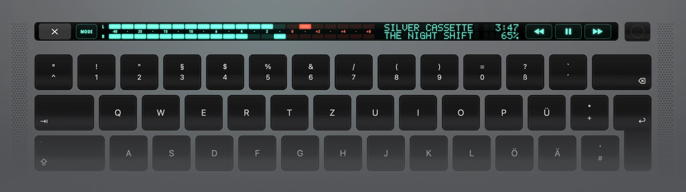</a>

So sieht Peak Hold Bar in der Touch Bar aus – mit Titel, Spielzeit und Lautstärke.

## Warum es Peak Hold Bar gibt

Ich habe Peak Hold Bar für mich gebaut. Früher lag ich oft vor meinem Tapedeck und habe der Musik beim Spielen zugeschaut: den Leuchtsegmenten, die im Takt hochspringen und an der Spitze kurz hängen bleiben. Manchmal habe ich das Deck sogar auf Aufnahme gestellt, wenn ich nur CD oder Radio gehört habe – nur um die Aussteuerungsanzeige zappeln zu sehen.

Genau diese Anzeige wollte ich auf meinem Mac wiederhaben. Jetzt teile ich sie mit allen, die das auch vermissen.

## Funktionen

- **Systemton ohne Zusatztreiber:** nutzt die Systemaudio-Erfassung von macOS. Kein virtuelles Audiogerät, keine Kernel-Erweiterung.
- **Drei Anzeigeorte, frei kombinierbar:** Touch Bar, **Menüleiste** und ein Fenster auf dem Bildschirm (im Touch-Bar-Look oder als vertikales Tape-Deck-Meter). Läuft auf **jedem Mac** – die Touch Bar ist ein Extra, kein Muss.
- **Titel, Interpret und Spielzeit** in einer Punktmatrix-Anzeige – aus „Läuft gerade“ des Systems (Plex, Safari/YouTube, Musik, Spotify, Podcasts …), direkt vom **Plex**-Server oder aus Browser-Tabs.
- **Bedienen wie ein Tapedeck:** Play/Pause, Weiter, Zurück und **Spulen** (◀◀/▶▶ halten), Lautstärke per Wischen über die Touch Bar.
- **PEAK und AVG:** Spitzenpegel wie beim Kassettendeck (20 dB/s Abfall) oder Durchschnitt mit Spitze darüber. Peak-Hold mit einstellbarer Haltedauer, **OVER**-Anzeige.
- **Vier Farben:** Blau (VFD), Grün, Bernstein, Weiß.
- **Synchron bei AirPlay und Bluetooth:** Das Meter wartet so lange, wie der Ton zum Lautsprecher braucht.
- **Sparsam:** weniger Bilder pro Sekunde im Akkubetrieb und bei Stille, Pause bei gesperrtem Bildschirm.
- **Deutsch und Englisch**, folgt der Systemsprache.

## So sieht es aus

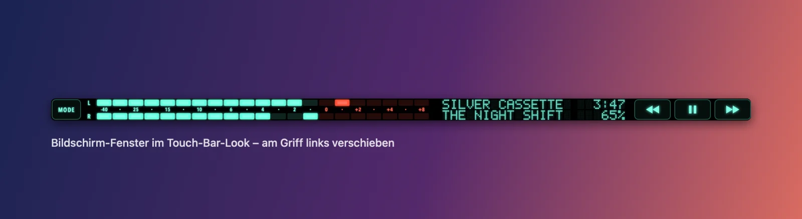 Das Bildschirm-Fenster – 1:1 wie die Touch Bar

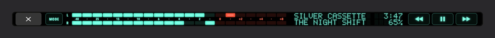 Touch Bar mit Titel, Spielzeit und Lautstärke

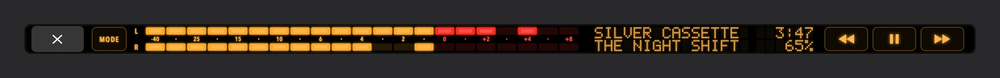 In Blau, Grün, Bernstein oder Weiß

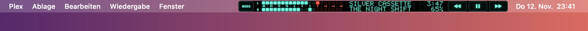 Dieselbe Anzeige in der Menüleiste

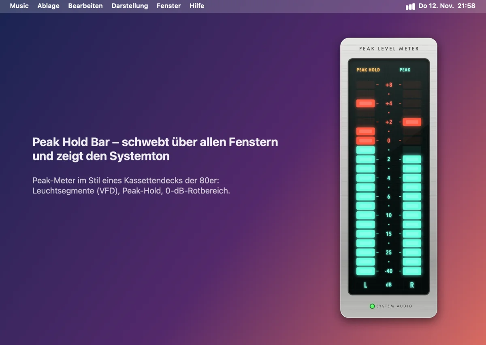 Klassisch senkrecht – wie bei einem Tape Deck der 80er

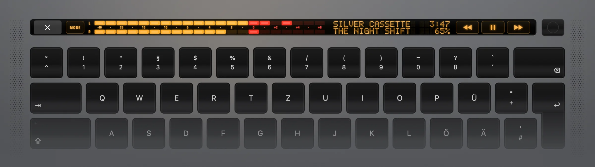

Mehr Bilder und alle Infos auf **[peakholdbar.com](https://peakholdbar.com/de)**.

**Im Detail:**

| Leise | Laut (roter Bereich, Peak-Hold) | AVG-Modus |
|:---:|:---:|:---:|
| 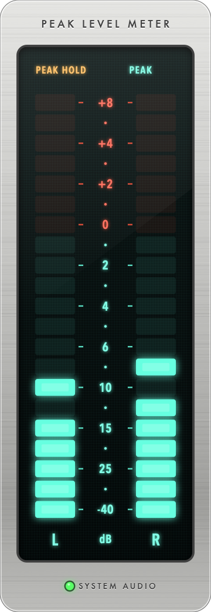 | 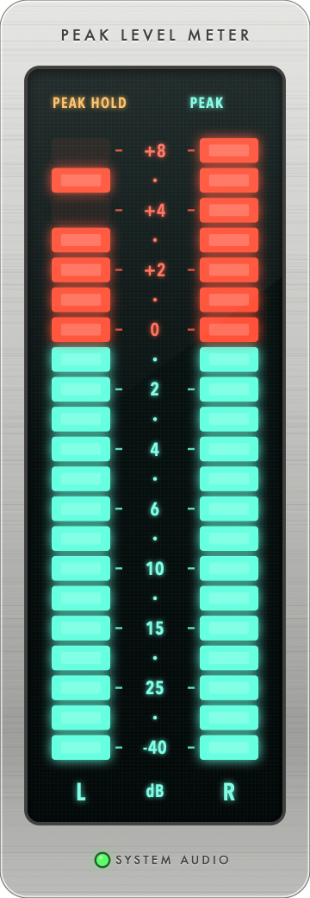 | 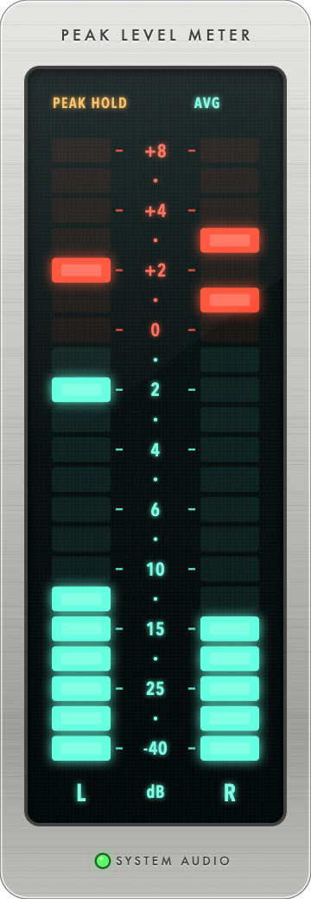 |

**VFD-Systemmenü** (MODE lange halten): Helligkeit, Lautstärke, Stumm, Tastaturlicht

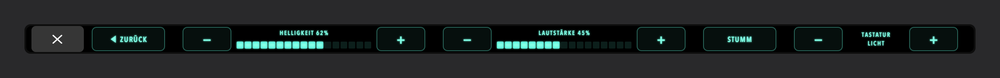

## Voraussetzungen

- macOS **14.2 Sonoma** oder neuer
- Apple Silicon oder Intel (eine Universal-App für beide)
- Touch Bar optional

## Installation

1. Die neueste **`Peak-Hold-Bar-x.y.z.dmg`** unter [Releases](https://github.com/ChrisMakesHis/PeakHoldBar/releases/latest) laden.
2. DMG öffnen und **Peak Hold Bar** in den Ordner **Programme** ziehen.
3. Starten. Die App ist mit einer Developer ID signiert und von Apple notarisiert – sie öffnet sich ohne Gatekeeper-Warnung.

Beim ersten Start führt eine kurze **Einrichtung** durch die Freigaben. Nötig ist nur eine: **Systemaudioaufnahme**, damit das Meter den Ton messen kann. Alles andere (Titel aus Musik, Spotify und Browsern, Plex, Start bei der Anmeldung) ist optional. Jede Freigabe fragt macOS erst, wenn du in der Einrichtung auf den passenden Knopf klickst.

## Updates

Peak Hold Bar sucht täglich nach einer neuen Version und installiert sie auf Wunsch selbst (*Einstellungen → Allgemein*). Jedes Update wird vor der Installation auf Signatur und Notarisierung geprüft.

## Bedienung (Touch Bar)

| Geste | Aktion |
|---|---|
| Ein Finger nach rechts/links wischen | Lauter/leiser |
| Einmal tippen | Play/Pause |
| Doppelt tippen | Nächster Titel |
| Dreimal tippen | Vorheriger Titel bzw. aktueller von vorn |
| ◀◀ / ▶▶ halten | Spulen |
| MODE lange halten | VFD-Systemmenü |

In der Menüleiste und im Fenster geht dasselbe mit Maus oder Trackpad. Alle Optionen stehen im Einstellungsfenster (⌘,).

## Datenschutz

Der Ton wird nur im Speicher in Pegelwerte umgerechnet – nichts wird aufgezeichnet, gespeichert oder übertragen. Details: [Datenschutzerklärung](https://peakholdbar.com/de/datenschutz).

## Hilfe & Kontakt

Probleme oder Fragen? In der App unter *Hilfe → Diagnose senden …* – das öffnet eine Mail an **support@peakholdbar.com** mit einem Diagnosebericht (ohne Titel, Passwörter oder Adressen).

## Unterstützen

Dir gefällt, was ich mache? Spendier mir einen Kaffee:

## Lizenz

Peak Hold Bar ist **Freeware**: kostenlos nutzbar, Quellcode nicht öffentlich, keine Weitergabe oder Veränderung, ohne Gewähr. Details: [LICENSE](LICENSE).

Peak Hold Bar enthält [mediaremote-adapter](https://github.com/ungive/mediaremote-adapter) von Jonas van den Berg und Mitwirkenden (BSD-3-Clause, Lizenztext in [LICENSE](LICENSE) und in der App). Danke!

## Hinweis

Für die Touch Bar **außerhalb** der eigenen App gibt es keine öffentliche Apple-API. Peak Hold Bar nutzt dafür, wie andere Touch-Bar-Tools, private Funktionen von macOS. Deshalb gibt es die App nicht im Mac App Store. Auf Macs ohne Touch Bar sind diese Aufrufe wirkungslos.

Ein Projekt von <a href="https://chrismakeshis.com">ChrisMakesHis</a> · © 2026 Christoph Deppe
