
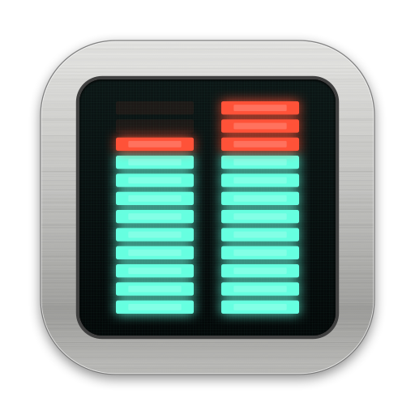

<h1 align="center">Peak Hold Bar</h1>

English · <a href="README.de.md">Deutsch</a>

A level meter for macOS in the look of an 80s tape deck – in the <b>Touch Bar</b>, the menu bar or as a window. 
Glowing segments like a vacuum fluorescent display (VFD), peak hold, red zone from 0 dB. 
It shows the <b>system audio</b>: everything your Mac is playing right now.

<a href="https://github.com/ChrisMakesHis/PeakHoldBar/releases/latest"><b>⬇ Download (DMG)</b></a> · <a href="https://peakholdbar.com/en">peakholdbar.com</a> · Freeware

<a href="https://peakholdbar.com/en">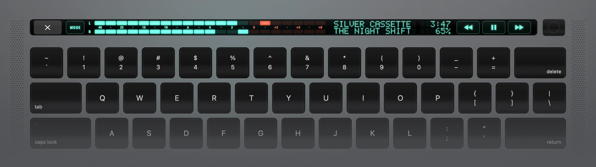</a>

This is Peak Hold Bar in the Touch Bar – with title, playing time and volume.

## Why Peak Hold Bar exists

I built Peak Hold Bar for myself. Back in the day I often lay in front of my tape deck and watched the music play: the glowing segments jumping up to the beat and hanging at the top for a moment. Sometimes I even put the deck into record mode while I was just listening to a CD or the radio – only to watch the level meter dance.

That's exactly the display I wanted back on my Mac. Now I'm sharing it with everyone who misses it too.

## Features

- **System audio without extra drivers:** uses the system audio capture built into macOS. No virtual audio device, no kernel extension.
- **Three display locations, freely combinable:** Touch Bar, **menu bar** and a window on the screen (in the Touch Bar look or as a vertical tape deck meter). Runs on **any Mac** – the Touch Bar is a bonus, not a requirement.
- **Title, artist and playing time** in a dot-matrix display – from the system's Now Playing (Plex, Safari/YouTube, Music, Spotify, Podcasts …), straight from a **Plex** server, or from browser tabs.
- **Control it like a tape deck:** play/pause, next, previous and **spooling** (hold ◀◀/▶▶), volume by swiping across the Touch Bar.
- **PEAK and AVG:** peak level like a tape deck (20 dB/s release) or average with the peak above it. Peak hold with adjustable hold time, **OVER** indicator.
- **Four colours:** blue (VFD), green, amber, white.
- **In sync with AirPlay and Bluetooth:** the meter waits as long as the sound takes to reach the speaker.
- **Light on energy:** fewer frames per second on battery and during silence, paused while the screen is locked.
- **English and German**, follows the system language.

## What it looks like

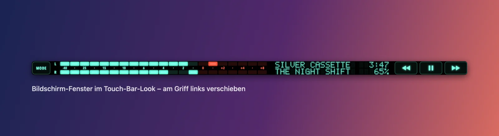 The on-screen window – identical to the Touch Bar

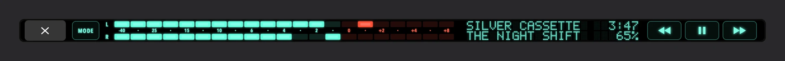 Touch Bar with title, playing time and volume

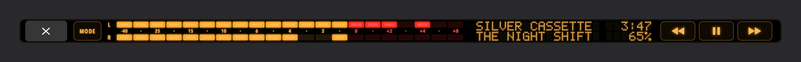 In blue, green, amber or white

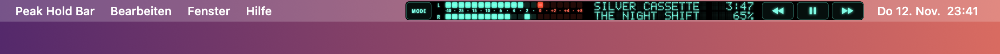 The same display in the menu bar

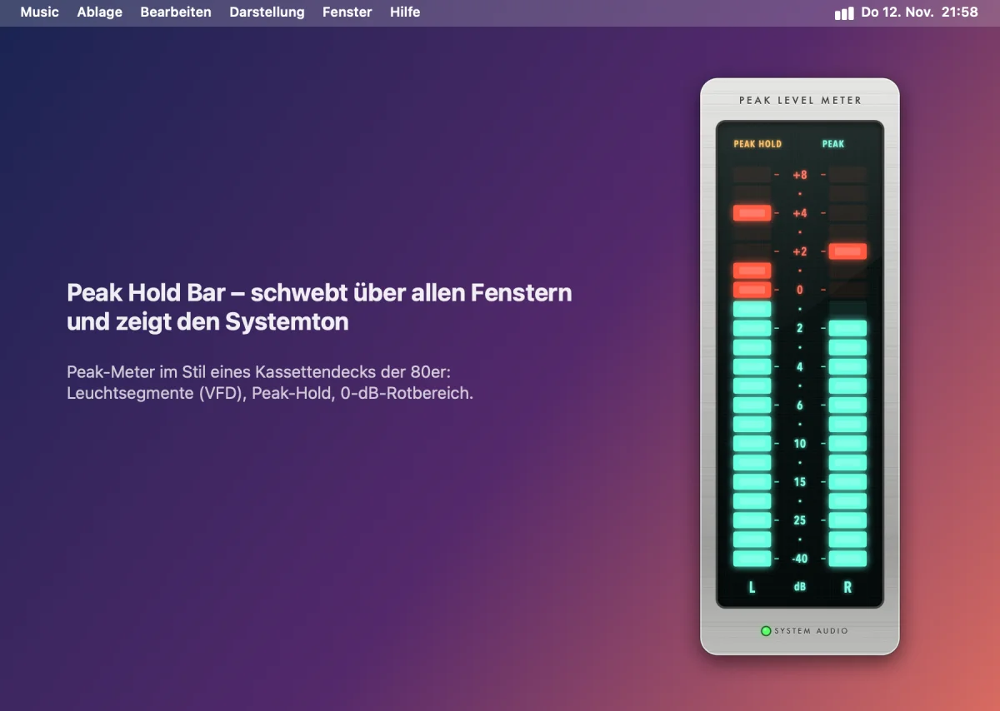 Classic upright layout – like an 80s tape deck

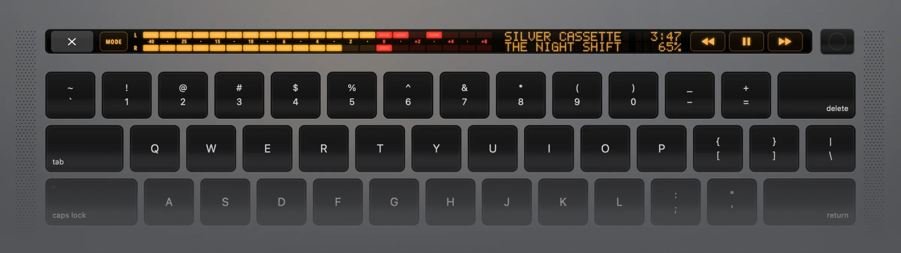

More pictures and all the details at **[peakholdbar.com](https://peakholdbar.com/en)**.

**In detail:**

| Quiet | Loud (red zone, peak hold) | AVG mode |
|:---:|:---:|:---:|
| 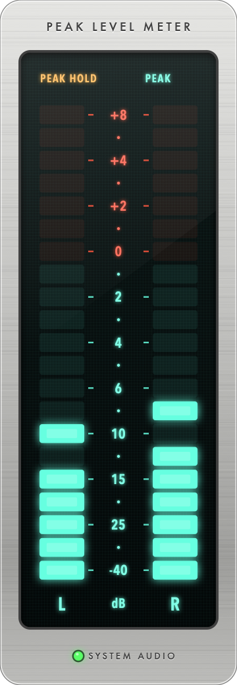 | 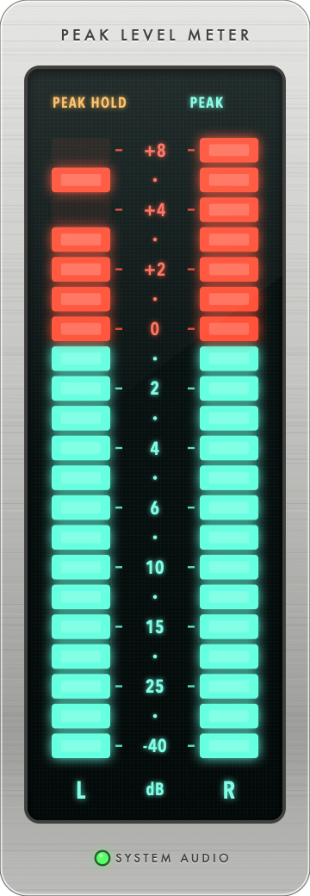 | 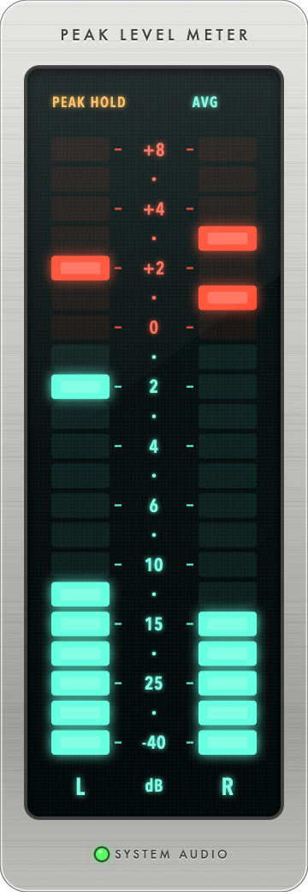 |

**VFD system menu** (hold MODE): brightness, volume, mute, keyboard light

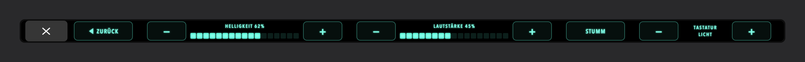

## Requirements

- macOS **14.2 Sonoma** or later
- Apple silicon or Intel (one universal app for both)
- Touch Bar optional

## Installation

1. Download the latest **`Peak-Hold-Bar-x.y.z.dmg`** from [Releases](https://github.com/ChrisMakesHis/PeakHoldBar/releases/latest).
2. Open the DMG and drag **Peak Hold Bar** to the **Applications** folder.
3. Launch it. The app is signed with a Developer ID and notarized by Apple – it opens without a Gatekeeper warning.

On first launch a short **setup** walks you through the permissions. Only one is required: **System Audio Recording**, so the meter can measure the sound. Everything else (titles from Music, Spotify and browsers, Plex, launch at login) is optional. macOS only asks for each permission when you click its button in the setup.

## Updates

Peak Hold Bar checks for a new version daily and installs it itself if you want (*Settings → General*). Every update is checked for its signature and notarization before it is installed.

## How to use (Touch Bar)

| Gesture | Action |
|---|---|
| Swipe one finger right/left | Louder/quieter |
| Tap once | Play/pause |
| Tap twice | Next track |
| Tap three times | Previous track or current track from the start |
| Hold ◀◀ / ▶▶ | Spool |
| Hold MODE | VFD system menu |

The menu bar and the window work the same with mouse or trackpad. All options are in the settings window (⌘,).

## Privacy

The sound is only turned into level values in memory – nothing is recorded, stored or transmitted. Details: [privacy policy](https://peakholdbar.com/en/privacy).

## Help & contact

Problems or questions? In the app, *Help → Send Diagnostics …* opens a mail to **support@peakholdbar.com** with a diagnostics report (without titles, passwords or addresses).

## Support

Like what I do? Buy me a coffee:

## License

Peak Hold Bar is **freeware**: free to use, source code not public, no redistribution or modification, no warranty. Details: [LICENSE](LICENSE) (German and English).

Peak Hold Bar includes [mediaremote-adapter](https://github.com/ungive/mediaremote-adapter) by Jonas van den Berg and contributors (BSD 3-Clause, licence text in [LICENSE](LICENSE) and in the app). Thank you!

## Note

There is no public Apple API for the Touch Bar **outside** your own app. Like other Touch Bar tools, Peak Hold Bar uses private macOS functions for it. That's why the app isn't in the Mac App Store. On Macs without a Touch Bar these calls have no effect.

A project by <a href="https://chrismakeshis.com">ChrisMakesHis</a> · © 2026 Christoph Deppe
